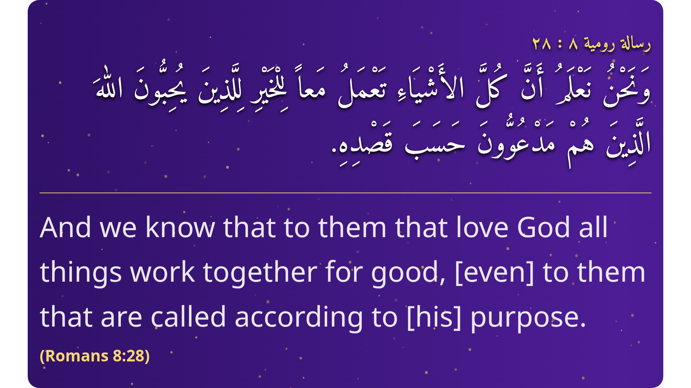
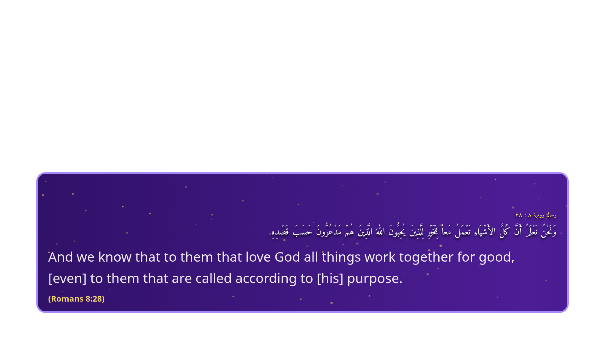
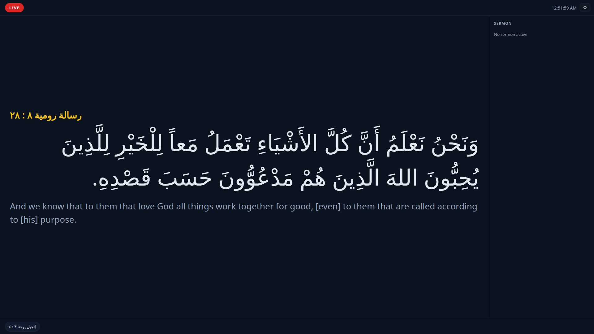
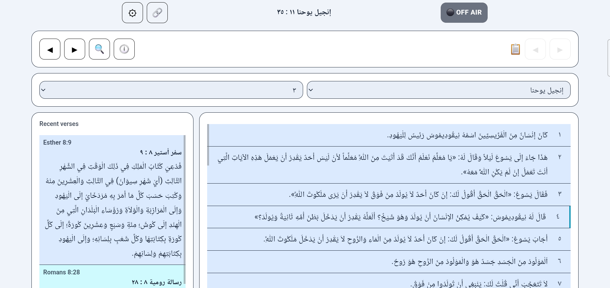
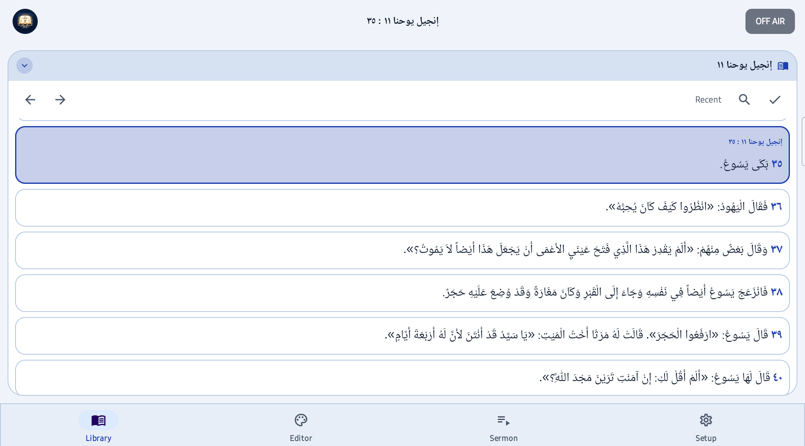
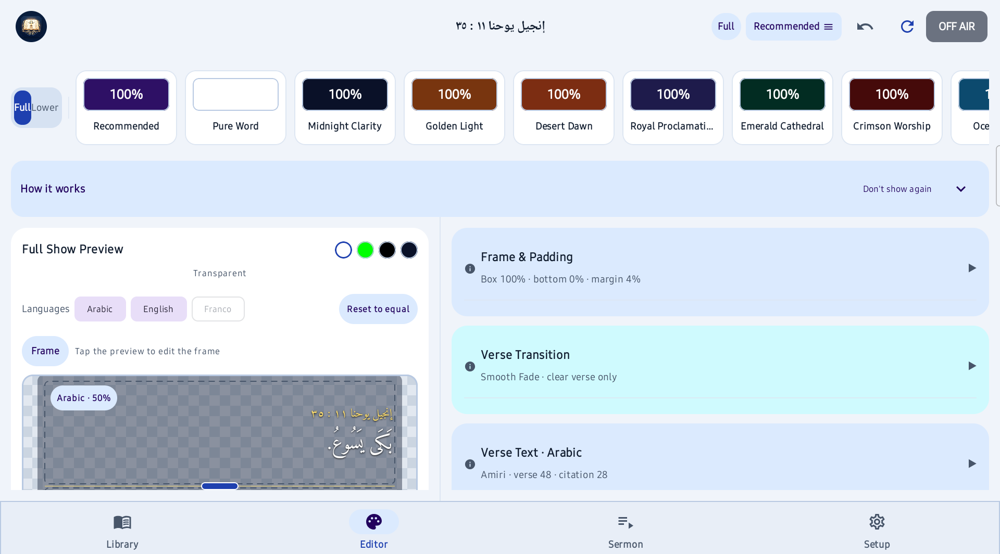
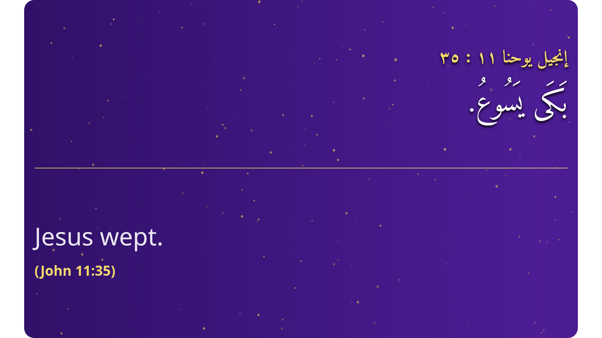

# Arabic Christian Presenter

**Your tablet is the broadcast. One tap puts the verse on the projector, the stream, or both — in Arabic and English, beautifully styled, over real NDI. Built by a pastor who preaches with it live, every service.**

> 📲 **Download v1.12.7 now** — get the signed APK from the [v1.12.7 release](https://github.com/ArabicChristianMedia/Arabic-Christian-Presenter/releases/tag/v1.12.7). Google Play availability is coming soon.

---

## Built for live. Trusted in the service.

- **It stays on air.** Broadcasting runs as a foreground service: the server, both NDI senders, and the last live verse come back on their own after an OS kill.
- **One tap, and the verse is live.** No menus to fight while you preach. A volunteer can run the service after one rehearsal.
- **No internet at the venue. No account. No subscription.** Everything runs on your own Wi-Fi — fully offline, fully yours.

## One tap. On air.

1. **Prepare** — share a note from Google Keep (or any Bible app); references become your sermon list.
2. **Tap** — one tap puts the verse live.
3. **Step** — arrow keys / a foot pedal step through the sermon in order.

## Two real NDI sources, plus the web

- **Two genuine NDI® 6 sources, simultaneous and independent** — Lower and Full, each with its own style, resolution (up to 1080p, all 16:9), and frame rate. They appear under your device's name in NDI Studio Monitor, OBS, vMix, and any NDI receiver.
- **HTTP overlays that match NDI** — `/lower` and `/full` as transparent browser sources, live and reconnect-safe.
- **Your helpers run it with you** — anyone on the team opens `/remote` on their phone (trigger verses, step the sermon) or `/stage` (the preacher's view) in a browser. No app to install, no account.

## A design studio, not a template picker

Professionally designed styles for lower thirds and full shows — every value is yours: card, glow, borders, alignment, transitions, motion. 68 bundled font families (56 Arabic, 12 Latin), zero downloads, fully offline. Particle effects, motion-video backgrounds, your own looping MP4. Styles share as JSON.

## The Bible Library — fully offline

Complete Arabic Bible (Smith–Van Dyke) with optional tashkeel — 31,101 verses fully vocalized. Two English translations bundled (ASV, KJV). Fast offline search with Arabic normalization. Arabic + English shown together, direction-aware.

## Screenshots

| | |
|---|---|
|  |  |
| Lower-third output | Stage monitor — the preacher's view |
|  |  |
| Remote control from any browser | The Library — tap a verse to show it |
|  |  |
| The Editor — design your own styles | Full-screen output — John 11:35 |

All screenshots in [`docs/screenshots/`](docs/screenshots/).

## Install

Requires **Android 7.0+**.

1. Download the signed APK from the [v1.12.7 release](https://github.com/ArabicChristianMedia/Arabic-Christian-Presenter/releases/tag/v1.12.7).
2. Your phone will ask to allow installs from the browser — allow it (the APK comes straight from this page).
3. Install, open, and pick your Bible languages in Setup.

Google Play availability is coming soon.

## Learn more

- [Features](https://arabicchristianmedia.com/features/) — everything the app does
- [How it works](https://arabicchristianmedia.com/how-it-works/) — the service workflow
- [Comparison](https://arabicchristianmedia.com/comparison/) — how it compares with ProPresenter, OpenLP, Quelea, and the Arabic Bible apps
- [arabicchristianmedia.com](https://arabicchristianmedia.com/) — the full site, in English and Arabic

## Contact

Questions, or want the app for your church? [info@arabicchristianmedia.com](mailto:info@arabicchristianmedia.com) — or the [contact form](https://arabicchristianmedia.com/contact/).

## Support Through Prayer

Arabic Christian Presenter is built for churches and ministries, freely given for the work of the Kingdom. There is no donation link — the best way to support this project is to **pray for it**. Prayers are deeply appreciated.

*"Freely you have received; freely give." — Matthew 10:8*

---

*NDI® is a registered trademark of Vizrt NDI AB; this project uses the NDI 6 runtime and is not affiliated with or endorsed by Vizrt.*
